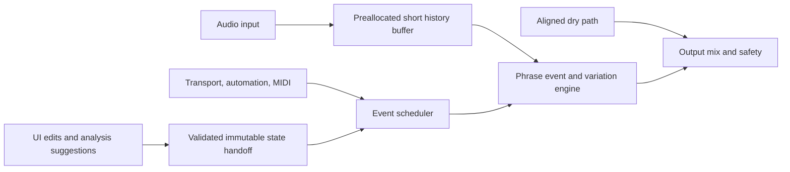
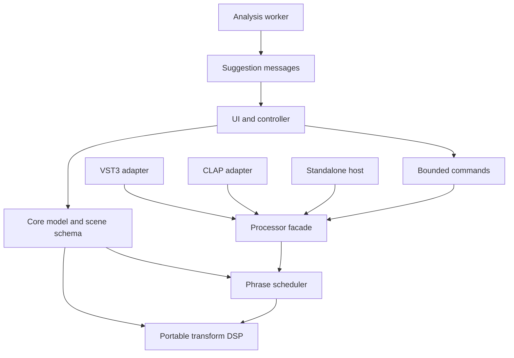

# GrooveMorph — Developer Specification Package

**Status:** Original research-backed requirements with approved direction and current implementation overlay; incomplete release acceptance
**Research date:** 2026-10-10  
**Repository:** [djshellshoxxx/GrooveMorph](https://github.com/djshellshoxxx/GrooveMorph) — current source inspected at main 61d5156 on 2026-10-13; runtime 7f2784a is integrated.
**Name:** Working name; branding and product name remain open.

## Current implementation overlay (2026-10-13)

This document retains requirements, future designs and original research history;
it is not a claim that every described capability is implemented. Main delivers
four editable operation-setting variations, five bounded-history effects, one
Scheduler, selectable Automatic/Host PPQ/Sample Clock, MIDI input, scene undo,
audition/compare, host state and VST3/Standalone builds. Windows/Linux builds,
portable sanitizers and Windows startup passed at 7f2784a. DAW/device/performance
acceptance remains unverified. See [TODO](TODO.md), [feature audit](feature-audit/FEATURE_AUDIT_2026-10-13.md)
and [timing contract/evidence](TIMING_INTEGRATION_HANDOFF.md).

FR-001/002 remain partial: phrase origin/subdivision authoring and event lanes are
absent; the phrase display currently shows bars/cursor only. Operation settings
are scene state rather than host automation parameters. Host Variation readback
and duplicate MIDI mapping gaps are reproduced. Undo applies to scene-bank edits,
not global APVTS controls. No external preset-bank browser is delivered.

Later lane/event/model/parameter examples below are target designs, not frozen
public interfaces or shipped IDs. Preserve actual IDs in PluginProcessor.h.
F01–F12 expansion direction is approved, but PR #6 technical specs remain drafts;
PR #9 is only an unmerged planner core with a Linux compilation blocker. Do not
mark proposals complete or remove unmet requirements just to match current code.
Original source-access dates and provisional numeric targets remain unchanged.

## 1. Project inputs and critical unknowns

GrooveMorph is proposed as a real-time rhythmic audio effect with a standalone test application. It is intended for electronic music producers, DJs, beatmakers, sound designers, and performers. The product premise is that users work with musical phrases, named variations, and transitions, rather than only drawing one effect lane or choosing a preset. The research brief initially treated Windows, Linux, VST3, CLAP, and standalone as provisional targets. A later repository decision approved C++20, JUCE, CMake, VST3, and JUCE Standalone for the current spike, with CLAP deferred; see the repository decision overlay below.

The product owner has not decided supported DAWs/versions, capture duration, acceptable latency, whether pitch-preserving stretch is needed, exact trigger sources, multiband/random features, or reusable-scene file behavior. These affect architecture and release scope. Recommendations below make each choice explicit and keep irreversible commitments out of the MVP.

### Status labels

- **Confirmed input:** directly stated in the project brief.
- **Assumption:** provisional interpretation used to make requirements coherent.
- **Recommendation:** proposed decision for owner review.
- **Open:** owner decision or verification required before release.

### Repository decision overlay (approved 2026-10-10)

The repository records the following decisions as approved for the current engineering phase. They take precedence over provisional format and stack recommendations elsewhere in this research package:

- Build system and framework: CMake + JUCE.
- Current deliverables: VST3 and JUCE Standalone, for Windows x64 and Linux x86_64.
- CLAP is deferred unless the owner explicitly requests it after M0 validation.
- Reference hosts: REAPER on Windows x64 and Linux x86_64.
- MVP: phrase variations and transition policy using bounded short-window rhythmic operations. Full phrase capture and pitch-preserving stretch remain out of scope.
- The M0 spike must validate build, host load, state/parameter behavior, low-latency constraints, and bounded operation feasibility before broader implementation.

These are product/repository approvals; build success, host behavior, and performance remain unverified until measured.

## 2. Executive summary

**Recommended first release:** a stereo phrase-aware rhythmic effect with a beat/bar grid, four editable variations, a small set of time/volume transformations (repeat/stutter, reverse slice, gate, half-time feel, and tape-stop-like slowdown), scheduled transitions, host sync, manual/MIDI/automation triggering where available, a controlled audition/compare flow, undo, and host preset recall. Phrase timing can come from host transport or user-entered tempo and phrase length; optional transient detection suggests timing but never silently overrides it. A short, preallocated ring buffer enables bounded look-behind for rhythmic slices. Full phrase capture and long-form reverse/re-render are not MVP dependencies.

This MVP tests the distinctive hypothesis: **a musician can make, compare, and perform several musically related rhythmic treatments of a phrase, then choose how they enter and leave.** The combination of variations plus transition policy is a plausible product distinction, but research does not establish market demand or novelty. Many listed products already offer time/volume manipulation, drawing, triggering, sequenced effects, multiband processing, and MIDI playability.

**Critical engineering constraint:** long phrase capture, reverse, and time manipulation require access to past samples and therefore latency, buffering, or a non-live render model. Plugin delay compensation cannot make monitoring latency disappear. Keep the first release low-latency by operating on bounded short slices and musical timing metadata; offer full captured-phrase playback later only with an explicit, measurable latency mode and host-tested reporting. Do not imply that beats/transients can be inferred reliably for all material.

**Recommended stack (current repository approval):** C++20, CMake, and JUCE for the shared processor/UI and VST3/standalone, subject to the M0 build and target-host checks. CLAP remains deferred unless the owner reopens it; if reopened, validate the selected JUCE version/adapter against the CLAP validator and target hosts. CLAP has a stable C ABI and first-party SDK, but the JUCE CLAP extension research surfaced official-roadmap statements and a separately maintained community adapter; do not assume equivalent host-format support across JUCE versions. If the adapter is unacceptable, compare iPlug2 and a native CLAP wrapper before locking the stack. Use REAPER on Windows and Linux as the first reference host because its current documentation lists VST3 and CLAP on both systems. Add other hosts based on owner usage.

### Recommended release boundary

| Classification | Features |
|---|---|
| Core MVP | Stereo in/out; phrase length and grid; host transport sync and manual tempo fallback; four variations; visual timing lanes; repeat/stutter, reverse short slice, gate, half-time feel, tape-stop-style rate curve; transition modes: immediate, next beat, next bar, phrase boundary, manual trigger; intensity; undo/redo; audition/compare; parameters, state, and preset recall; MIDI note and automation triggers when host supports them; deterministic reset/seed; readable uncertainty/status feedback. |
| Recommended after MVP validation | Optional transient suggestions with confidence and manual correction; mono/stereo layout coverage; save/load variation banks as documented files; host-trigger capability matrix; performance mode with large scene controls; CPU/performance profiling across target systems. |
| Deferred | Full phrase capture and phrase-length latency mode; pitch-preserving time stretch; multiband protection; automatic kick/low-end classification; generative/random scene generation; broad effect suite (filter, pan, texture); audio-file import; sidechain/audio transient trigger input; MIDI output; scene exchange format until schema proves stable. |
| Out of scope for first release | Cloud/account/telemetry; online processing; automatic “musical understanding” claims; arbitrary multitrack slicing; built-in DAW/arranger; standalone recording studio; mobile, AU/AAX, and macOS until separately selected. |

## 3. Product definition and use cases

### Goals

1. Let a user create several named rhythmic variations from one phrase timing model.
2. Let the user decide when and how a variation becomes active.
3. Make the phrase grid, active variation, next transition, trigger source, and transformed regions visible.
4. Keep the main processing path deterministic, bounded, and real-time safe.
5. Preserve project/preset state and behave predictably when host timing or trigger support is absent.

### Non-goals

No guarantee of automatic tempo/key/groove understanding; no promise of zero latency for arbitrary reverse/long capture; no necessity to include a full multi-effect rack; no requirement for network connectivity, user account, analytics, or cloud storage.

### Users and representative journeys

- **Quick-result producer:** insert effect → use host tempo → choose a phrase length → pick a variation → audition → apply a phrase-boundary transition → automate intensity.
- **Advanced editor:** correct bar origin/grid → edit repeat/reverse/gate lanes → set protected first beat and per-step probability only if enabled → compare A/B → save preset → automate variation ID/transition.
- **Live performer:** prepare four large named variations → assign MIDI notes → see ready/active/queued feedback → trigger a transition quantized to beat/bar → use manual override if host timing disappears.
- **Standalone tester:** select audio device, sample rate, block size and test signal/input → run the same processor → inspect transport simulation, CPU, and status. Standalone is a validation harness, not a separate product workflow in MVP.

### Important edge journeys

Host lacks tempo; tempo is stopped or changes; transport seeks/loops; timing jumps backwards; host reports unsupported channel layout; no MIDI event arrives; MIDI note-off occurs after a scene change; plugin state is malformed/old; user changes sample rate/block size; plugin is bypassed while a transition is queued; analysis confidence is low; preset references an unavailable external file (MVP must not require one).

## 4. Competitive workflow research

This is a comparison of documented positioning/capabilities, not a quality ranking or claim that products lack undocumented features.

| Product | Documented overlap | GrooveMorph opportunity to test |
|---|---|---|
| Image-Line Gross Beat | Real-time stream playback, pitch/position/volume manipulation; 2-bar rolling buffer; time and volume mapping envelopes for glitch, stutter, scratching, gating. | Organize the main task as several phrase variations plus an explicit transition policy, rather than only selecting/drawing mapping envelopes. This is a workflow distinction, not established novelty. |
| Cableguys ShaperBox 3 | Multiple shapers including Time and Volume, three-band processing, MIDI/audio triggering, and drawable modulation. | Lower-complexity variation authoring and clear phrase-level switching/transition semantics. Do not compete on number of shapers. |
| Sugar Bytes Looperator | Loop slicing/rearrangement and sequenced effects; desktop availability documented for Windows and macOS. | Variation comparison, correction of phrase grid, and explicit transition controls. |
| Sugar Bytes Effectrix 2 | Real-time audio manipulation and effect sequencer; current product page describes a sequencer workflow and Windows/macOS 64-bit availability. | Treat each variation as a named phrase state with transition behavior; keep editing understandable without expanding into a large effect inventory. |
| iZotope Stutter Edit 2 | Playable effect triggered by MIDI; banks/gestures; Auto mode and ranges for effect motion. | Make variations directly visible/editable as phrase structures and provide more than trigger-to-gesture selection through phrase transition controls. |
| Devious Machines Infiltrator 2 | Sequenced effect modules and modulation; manual documents 32-step sequencer and MIDI routing. | Put phrase variations and transitions ahead of multi-effect chain complexity. |

**Positioning conclusion:** time manipulation, stutter, reverse, gating, drawn modulation, MIDI trigger, multiband, and sequencing are already present in the market. The less-common combination to validate is a deliberately phrase-centered, multi-variation workflow with explicit transition behavior and conservative guardrails. Run user interviews/prototype testing before marketing uniqueness or demand.

## 5. Feature requirements

Requirement IDs are stable. Priorities: **P0** release-blocking; **P1** recommended; **P2** deferred/optional. Source tags: **B** brief; **R** research-backed; **A** assumption; **D** design recommendation.

| ID | Pri. | Requirement / rationale | Acceptance criteria | Verification |
|---|---:|---|---|---|
| GM-FR-001 | P0 | The processor shall expose phrase length, phrase origin, beat subdivision, and sync source. (B/D) | User can select a documented bar/beat length; grid displays the same boundaries used by scheduling. | Unit tests over tempo, meter, origin and sample-rate fixtures; UI test. |
| GM-FR-002 | P0 | It shall provide four named variations with independent rhythmic event data. (B/D) | Editing one variation does not mutate another; each can be selected and recalled. | State isolation tests; serialization round trip. |
| GM-FR-003 | P0 | It shall provide repeat/stutter, reverse-slice, gate, half-time-feel, and rate-ramp/tape-stop-style operations. (B) | Every operation has a defined range, timing unit, boundary policy, and bypass value; no operation writes outside its audio buffer. | DSP unit tests using impulses, ramps, sine and drum fixtures; bounds/sanitizer tests. |
| GM-FR-004 | P0 | It shall schedule a variation switch as immediate, next beat, next bar, next phrase, or user-triggered. (B) | Scheduled time is visible; host timing available = sample-aligned to event/quantization boundary; otherwise uses configured fallback. | Deterministic timeline tests at multiple tempos and block sizes. |
| GM-FR-005 | P0 | It shall expose master intensity and per-operation enable/depth. (B/D) | At zero intensity the processed output equals defined dry path within numerical tolerance; parameter updates do not click beyond threshold GM-QR-004. | Null/difference and automated ramp tests. |
| GM-FR-006 | P0 | It shall accept host tempo, time signature, play state and musical position when available; otherwise provide manual tempo/meter and free-run fallback. (B/R) | UI clearly identifies source and missing fields; no division by zero or invalid timeline after missing/invalid context. | Host integration tests; mocked absent/invalid context. |
| GM-FR-007 | P0 | It shall allow automation of continuous controls and variation selection. (B/R) | Host-visible parameter IDs/names remain stable; discrete changes have defined quantization and automation behavior. | Parameter contract tests and target-host automation tests. |
| GM-FR-008 | P0 | It shall accept MIDI note triggers when the format/host provides event input. (B) | Configurable note map; note-on selects/queues mapped variation; note-off behavior is explicit and defaults to no unexpected scene revert; missing MIDI degrades visibly to manual/automation operation. | MIDI event timestamp tests; target-host routing tests. |
| GM-FR-009 | P0 | It shall provide audition/compare and undo/redo for user edits. (B) | Audition never silently changes persisted scene; undo/redo restores scene data exactly; audio-thread state changes only at safe block boundaries. | UI workflow tests; state equality tests. |
| GM-FR-010 | P0 | It shall save/restore all user-visible processor state through host state APIs. (B/R) | Round-trip of all parameters/scenes gives identical serialized model; malformed/unknown version loads defaults safely and reports recovery. | Serialization fuzz/round-trip tests; host project reload. |
| GM-FR-011 | P0 | It shall show active/queued variation, transition point, sync source, capture/analysis status, and unavailable trigger inputs. (B/D) | Status is communicated by text/icon plus color; no state is conveyed by color alone. | Accessibility/UI review and state-driven screenshot tests. |
| GM-FR-012 | P0 | It shall provide host bypass and internal dry/wet with defined click-free transitions. (R/D) | Host bypass state is saved if plugin provides it; switching meets GM-QR-004 and latency-compensated dry path is aligned. | Impulse alignment and bypass sweep tests. |
| GM-FR-013 | P1 | It may suggest beat/transient locations with confidence and manual correction. (B/D) | Suggestions are labeled estimates; confidence/uncertainty visible; user edits override analysis; no low-confidence automatic change is committed. | Labeled fixture set; precision/recall reporting, usability test. |
| GM-FR-014 | P1 | It should protect the first beat and optionally constrain low-frequency transformation only after multiband design is validated. (B/D) | Protected regions are visible and audibly unchanged within defined tolerance; unsupported option is disabled with explanation. | Compare protected/unprotected test signals. |
| GM-FR-015 | P1 | It should support deterministic controlled variation with explicit seed and limits if random variation is approved. (B/D) | Same seed + same scene + same input yields same event sequence; constraints are never exceeded. | Seed reproducibility/property tests. |
| GM-FR-016 | P2 | It may load/save standalone scene-bank files after schema and migration rules are agreed. (B/D) | File validation, version migration, and atomic replacement are specified before implementation. | Import/export fuzz tests; compatibility fixtures. |
| GM-FR-017 | P2 | It may support audio trigger/sidechain only where port layouts and host routing are proven. (B/R) | Trigger input is optional; absence never breaks main audio path; status explains missing input. | Host layout/routing matrix. |
| GM-FR-018 | P2 | Full phrase capture shall be an explicit mode with a stated maximum duration, latency, memory and transport policy before implementation. (B/R) | Capture limit and reported latency are measured for each accepted sample rate/phrase setting; over-limit requests are rejected before allocation. | Memory/latency tests and host PDC tests. |

## 6. Audio behavior and DSP specification

### 6.1 Signal and control flow

### 6.2 Proposed MVP audio contract

- Effect accepts mono or stereo input and outputs the same layout. Mono must remain mono; stereo image is preserved unless an explicit operation changes it. No sidechain bus is required in MVP.
- Process incoming audio in host-sized blocks. Preallocate ring buffers and scratch buffers in prepare/activation. No allocation, file I/O, logging, mutex wait, UI call, or unbounded loop on the audio thread.
- Phrase boundaries are represented in musical position when host provides it; convert to sample offsets using the current tempo and sample rate. On tempo/meter/transport discontinuities, re-anchor scheduler at the next valid boundary, apply a short transition ramp, and surface the event if it changes queued scheduling.
- Support variable block sizes. Host block boundaries do not define musical boundaries; events can occur at sample offsets within a block when host event timestamps allow it. Otherwise document block-quantized fallback.
- Short reverse/repeat operations may reference bounded past samples in the preallocated history buffer. If requested window exceeds configured capacity, clamp only if UI clearly displays the clamp; otherwise reject before execution and leave audio on safe dry path.
- Initial MVP should not require full-phrase capture, long reverse, pitch-preserving stretch, file import, or analysis in real time. A future capture mode must explicitly state that reading a completed phrase backward/at altered duration adds latency or requires a capture-then-play workflow.

### 6.3 Timing and boundaries

- Internal canonical time: signed 64-bit sample counter plus beat-position representation with fractional beat; no float accumulation for long-running beat phase.
- Use host musical time when valid, manual BPM/meter if host fields are absent, and free-running wall/sample time only when user selects it. Do not infer tempo silently from system clock.
- Every operation defines: start boundary, source window, output duration, crossfade/edge policy, and behavior when phrase length is shorter than operation window.
- A transport start/seek/loop or backwards position jump resets/reanchors scheduler state; it must not read uninitialized history. Preserve user scene state and persistent parameters.
- Tempo changes: update the musical scheduler at a block boundary; preserve any in-progress transition by mapping remaining normalized transition phase, then align the next scheduled event to the new grid. This is a recommendation requiring listening tests.
- Stopped transport: manual preview may run in free-run only by explicit user action. Otherwise pass through and show stopped/armed state. Host automation still updates parameter state without forcing audio playback.

### 6.4 Transitions, click prevention, dry/wet and bypass

- Scene data is prepared off the audio thread, validated, then published as an immutable snapshot through a lock-free or bounded handoff. Audio thread swaps snapshots only at a defined block/event boundary.
- At variation switch, use event-aligned crossfade or operation-specific ramp. Do not crossfade buffers with unrelated phase when it creates comb filtering; operation transitions should use defined phase/reset rules and audio tests.
- Parameter smoothing is per-parameter: continuous gain/depth/cutoff-like values may ramp; discrete operation selection should use crossfade/state switching. Host automation events with sample offsets should be honored where format/host exposes them.
- Internal dry path must match processed path latency. Host bypass behavior should pass audio with the same effective latency where the API/host behavior permits. Never report zero latency if processing introduces delay.
- Tail policy: expose/document tail length for the selected effects; for MVP time slicing does not synthesize an indefinite tail. Reset clears transient buffers/state without resetting saved parameter values.

### 6.5 Analysis recommendation

Use analysis only to propose, not dictate, the beat grid. A computationally bounded detector can use energy/spectral-flux onset candidates and tempo hypotheses over a finite rolling window, with confidence derived from periodicity/stability. Polyphonic, syncopated, sparse, swung, ambient, and non-percussive content create ambiguity. UI must allow user grid-origin, tempo and subdivision edits. Keep analysis on a worker thread fed from a bounded audio snapshot; publish results through a queue. Never stall or allocate in `processBlock` for analysis.

### 6.6 Channel layouts and formats

MVP supports mono-in/mono-out and stereo-in/stereo-out. Reject unsupported layouts at activation with a clear host-visible state where possible; never silently drop or reorder channels. VST3 uses bus-arrangement negotiation; CLAP exposes audio ports/configs. Avoid dynamic layout changes while active unless host protocol requires it and the change is explicitly supported.

## 7. Quality requirements

Targets below are **proposed acceptance targets**, not externally established standards. Confirm with owner and hardware/host spike before freezing them.

| ID | Quality requirement | Proposed acceptance / verification |
|---|---|---|
| GM-QR-001 | Real-time safety | Static review plus thread-check/debug instrumentation finds no allocation, lock wait, I/O, or UI calls in audio process path; stress with varying buffers and automation. |
| GM-QR-002 | Resource use | MVP target: average CPU under 5% of one modern desktop core per stereo instance at 48 kHz/128 samples, and peak below 10% during maximum scene complexity; report test CPU model/compiler/host. Revisit after prototype benchmark. |
| GM-QR-003 | Memory | No unbounded growth; ring/scratch memory fixed at activation and documented. Proposed <=32 MiB per instance excluding framework/UI. Measure worst configuration at supported sample rates. |
| GM-QR-004 | Click-free switching | On deterministic sine and impulse tests, transition discontinuity peak <= -60 dBFS relative to full-scale test signal, excluding intentionally abrupt hard-cut mode; listening test with drum, bass and sustained content. Owner may adjust. |
| GM-QR-005 | Timing | Host-timed events within one sample when sample-offset data exists; otherwise <= one host block and UI labels that limitation. Test 44.1/48/88.2/96 kHz and 32–2048 sample blocks. |
| GM-QR-006 | Latency | MVP target zero algorithmic latency except any explicitly approved bounded slice lookahead; query/report exact latency in both formats. Host PDC test verifies dry/wet alignment within one sample. |
| GM-QR-007 | Determinism | Same binary/config/input/event stream/seed yields matching output within floating-point tolerance; reproducibility test across repeated runs and reset/seek scenarios. |
| GM-QR-008 | Reliability | 24-hour synthetic stress run per reference OS/format without crash, runaway memory, invalid memory access, or missed scheduler state; not a substitute for broad compatibility testing. |
| GM-QR-009 | State recovery | Corrupt/unknown state loads safe defaults without crash; save/load round trip preserves model and stable parameter IDs. |
| GM-QR-010 | Accessibility | Keyboard reachable controls and focus order; visible focus; labels/value text; status never color-only; UI remains legible at minimum supported size and 100–200% OS scaling. |
| GM-QR-011 | Portability | Core DSP and model compile without JUCE UI or OS headers; platform adapters limited to plugin/standalone, file paths, audio device APIs and GUI. |
| GM-QR-012 | Privacy/security | No network sockets, analytics, telemetry, account, or audio export in MVP; dependency inventory and license notices generated at release. |

The proposed numeric CPU, memory, click and timing criteria require a benchmark spike and owner acceptance. They are targets, not claims of achieved performance.

## 8. Platforms, stack and integrations

### Platform recommendation

| Target | Status | Minimum support policy |
|---|---|---|
| Windows x64 | Provisional MVP | Pick supported Windows baseline after JUCE/build tool and host matrix validation; MSVC toolset and runtime packaging pinned in build docs. |
| Linux x86_64 | Provisional MVP | Pick distribution baseline (recommend current Ubuntu LTS for CI and REAPER; test at least one additional mainstream distro before broad claim); document glibc/runtime and audio backend requirements. |
| VST3 | Recommended | Use Steinberg SDK current stable release or verified JUCE wrapper; test validator and REAPER. VST3 SDK is documented as MIT-licensed and Linux build steps are documented by Steinberg. |
| CLAP | Deferred | Excluded from current M0/MVP build unless the owner explicitly reopens the decision; retain the portable core boundary so a later adapter remains possible. |
| Standalone | Recommended harness | JUCE audio-device host or equivalent; same core processor; simulated host transport, MIDI input, audio input and test vectors. |
| macOS/AU/AAX | Open/deferred | Revisit after owner selects audience, signing budget, build environment and format obligations. |

### Stack decision

**Recommendation:** begin with C++20 + CMake + JUCE for VST3/standalone and common UI/audio infrastructure; build a short compatibility spike before committing CLAP. JUCE has documented VST3 and standalone support; current public feature page lists VST3, AU, AAX, LV2, and standalone-related tooling but does not list CLAP. The official CLAP repository documents a stable ABI, MIT license and validator. A community JUCE extension documents JUCE 6/7/8 support and currently mentions JUCE 9 work/support; validate exact status and licensing from pinned source at implementation start. If separate adapters make feature parity or maintenance unacceptable, evaluate iPlug2 and DPF against Linux GUI, VST3/CLAP, state/automation, build matrix and commercial licenses. Do not adopt C++ modules or a custom plug-in SDK in MVP.

**Licensing gate:** JUCE 9 has its own current EULA/tier terms; do not rely on older JUCE 7/8 summaries. Owner must select framework license based on Circuit Drift Labs entity/revenue/funding and closed/open-source decision. VST3 SDK and CLAP SDK licenses do not settle the framework license. Maintain SBOM/dependency and license notices.

### Integration contracts and graceful degradation

| Integration | Data used | If unavailable |
|---|---|---|
| Host transport | Tempo, meter, playing/stopped, musical position/loop/seek where provided | Show missing field; manual BPM/meter or free-run mode; never invent host tempo. |
| Host automation/state | Stable parameter IDs, normalized values, serialized scenes | Preserve known parameters; ignore unknown fields; migrate versioned state; report load fallback. |
| MIDI input | Timestamped note events and optional note-off | Trigger UI explains routing is unavailable; variations still work through manual controls and automation. MIDI is not assumed present on every effect-host path. |
| Audio trigger/sidechain | External audio bus only if format and host support | Deferred; main stereo bus remains available. |
| Audio file import | None in MVP | Not applicable. |
| Network/cloud | None | No network permission or service required. |

### Reference hosts and coverage

Start with REAPER on Windows and Linux as it publicly documents VST3 and CLAP support across those OSes. Add the owner’s actual DAWs once provided. Do not claim universal host compatibility from one host. Current test matrix: VST3 in REAPER Windows x64 and Linux x86_64; JUCE Standalone on both. Add CLAP only if the owner reopens the deferred decision; at least one independent host per released format before public beta if feasible. Record host version, OS build, audio backend, sample rate, buffer size, device, channel layout, automation/MIDI routing result, state recall, bypass, PDC and load/unload outcome.

## 9. Architecture and module catalog

### Dependency direction

`CoreModel` and `DSP` depend only on the standard library and explicitly approved portable DSP code. `PluginAdapters` map VST3 host contracts into core events and parameters; a CLAP adapter is a later optional extension if approved. `StandaloneHost` maps audio devices and simulated transport/MIDI. `UI` talks to an application/controller interface and bounded queues; it never calls DSP internals from its message thread. `AnalysisWorker` receives copied snapshots and emits suggestions; DSP does not depend on the analyzer.

### Module catalog

| ID / module | Responsibility and public contract | Ownership, dependencies, failure behavior and test seam |
|---|---|---|
| GM-MOD-01 CoreModel | `Scene`, `OperationEvent`, `PhraseGrid`, `TransitionPolicy`, `ParameterModel`; validate ranges and versioned IDs. | Owns immutable value data; standard library only. Invalid objects rejected with typed validation results. Property/serialization tests. Portable. |
| GM-MOD-02 PhraseClock | Convert host/manual position to beat/sample events; detect discontinuities; `advance(blockContext) -> fixed event list`. | No audio ownership; no allocation in realtime call; depends on CoreModel. Missing timing falls back by selected policy. Pure timeline tests. |
| GM-MOD-03 SceneScheduler | Queue manual/MIDI/automation scene selections; quantize to transition boundaries; resolve priority. | State owned by processor thread; consumes timestamped event views; fixed-size queue. Overflow drops newest noncritical request and raises status counter. Deterministic tests. |
| GM-MOD-04 AudioHistory | Fixed-size per-channel ring buffer for bounded history; read/write indexes and reset policy. | Audio thread owns cursors; allocate in prepare; no cross-thread reads. Capacity checked. Wraparound/property tests. Portable. |
| GM-MOD-05 TransformEngine | Execute event-level stutter/reverse-slice/gate/rate curve/half-time feel. Interface: `process(input, output, eventSpan, parameters)`. | Preallocated scratch; depends on AudioHistory and immutable parameters. Invalid events bypass safely. DSP fixtures and sanitizers. Portable. |
| GM-MOD-06 TransitionMixer | Switch/crossfade operation states and align dry/wet; process sample/event ramps. | Audio thread owns envelope state; no locking. Fallback to dry on invalid state. Impulse/click tests. Portable. |
| GM-MOD-07 StateCodec | Versioned encoding/decoding for parameters and scenes; no external assets in MVP. | Called outside real-time process; bounded input size, schema validation. Invalid state yields defaults + diagnostic. Fuzz/round-trip tests. Portable. |
| GM-MOD-08 CommandBridge | Bounded producer-consumer transport for UI edits, analysis suggestions, audio-thread status. | Explicit SPSC or bounded MPSC policy; avoid shared mutable scene graphs. Queue-full behavior defined. Concurrency stress tests. Portable core with adapter as needed. |
| GM-MOD-09 AnalysisWorker (P1) | Analyze bounded copied audio snapshots; estimate transient candidates/grid confidence. | Worker owns FFT/window scratch; never blocks process callback. Stale/cancelled result discarded by generation ID. Offline labeled corpus tests. |
| GM-MOD-10 PluginAdapters | VST3 lifecycle, ports, parameters, transport, MIDI, state, latency/tail, GUI handoff; CLAP adapter deferred. | Framework/API-specific; delegates all DSP. Unsupported host data maps to absent optional fields. Format validator + host matrix. |
| GM-MOD-11 StandaloneHost | Audio device setup, host-context simulator, input/test signals, diagnostics and shared processor. | Platform audio backend boundary. Device failure shown; no effect on plugin targets. Device/API tests. |
| GM-MOD-12 UserInterface | Quick mode and detail editor; scene lanes, grid, status, trigger mapping, undo/compare. | Message thread only; reads snapshots and submits commands. Stale data tolerated; status shows unavailable. UI automation/accessibility checks. |

### Audio-thread permitted operations

Read input buffers; write output buffers; bounded arithmetic; read immutable parameter/scene snapshots; update preallocated ring/scratch memory; pop timestamped fixed-capacity events; update atomics/lock-free status counters; invoke preallocated DSP. Prohibited: heap allocation/deallocation; mutexes/condition waits; disk/network; log formatting; UI callbacks; host calls not explicitly marked realtime-safe; unbounded container work; waiting for analyzer; dynamic FFT plan creation.

## 10. API and data contracts

These are design-level contracts, not implementation code.

### Core value types

- `BeatPosition { int64 wholeBeat; uint32 fractionQ32; }` — monotonic musical location when host provides it; discontinuities explicitly signaled.
- `PhraseGrid { numerator, denominator, phraseBars, origin, subdivision, syncMode }` — all fields validated; phraseBars drawn from supported UI range; MVP recommendation: 1/2/4 bars for grid only, not captured audio length.
- `SceneId` — stable UUID-like identifier; four scenes provisioned by default; display names do not identify persisted references.
- `OperationEvent { operationId, start, duration, sourceWindow, depth, enabled, edgePolicy }` — validated against max history and phrase bounds.
- `TransitionPolicy { triggerMode, quantization, fadeDuration, priority }` — trigger mode explicit; UI trigger, MIDI, automation, host phrase boundary.
- `ProcessContext { sampleRate, blockFrames, tempo?, meter?, playing?, musicalPosition?, discontinuity?, events }` — optional values are truly optional; never consume invalid/nonfinite values.

### Key interfaces

| Interface | Contract |
|---|---|
| `validateScene(scene, limits) -> ValidationResult` | Pure, bounded validation; returns field-specific issue codes; no mutation. |
| `scheduleSceneChange(sceneId, triggerTimestamp, policy) -> ScheduleResult` | Enqueue only; returns accepted/invalid/queue-full; no allocation; scene applies only at quantized boundary. |
| `processBlock(inputViews, outputViews, context, parameterEvents)` | Audio-thread only; no ownership transfer; pointers valid for callback duration; supports zero-frame/null buffers where adapter contract allows. Invalid context uses safe fallback; invalid buffers produce silence or pass-through per adapter-safe rule and increment status. |
| `serializeState(model) -> bytes` / `restoreState(bytes) -> RestoreResult` | Non-audio thread; schema versioned; cap input size; unknown fields ignored only when safe; preserve stable IDs; never load external paths. |
| `analyze(snapshot, settings, generation) -> AnalysisResult` | Worker only; bounded snapshot; cancellation/generation; confidence plus candidate grid; never changes active scene directly. |

### Stable parameter families

`sync_mode`, `manual_tempo`, `meter_numerator`, `meter_denominator`, `phrase_bars`, `grid_origin`, `active_scene`, `queued_scene`, `transition_quantization`, `transition_fade_ms`, `master_intensity`, `dry_wet`, per-scene operation enable/depth/timing, `protect_downbeat`, and MIDI note map. IDs must be stable and never repurposed after first public beta; new parameters append IDs. Discrete choices map to documented normalized values and display strings. Automation of scene selection uses a discrete parameter; MIDI trigger mappings are state data and not hundreds of host parameters.

## 11. Data, persistence and lifecycle

- Host state is the authoritative project recall in MVP. Store schema version, stable scene IDs, names, grid, operations, transition configuration, trigger map and parameters.
- Do not store captured audio in MVP. No external file references, network data, personal data, or telemetry.
- Restore transaction: parse into temporary model; validate full model; migrate supported prior schema; publish complete immutable model at safe boundary. On failure, load defaults rather than partially applying state; expose recoverable diagnostic in UI.
- Undo stack belongs to UI/controller, stores model diffs or bounded snapshots off audio thread. It must not serialize audio history.
- Independent scene-bank save/import/export is deferred until owner selects human-readable vs binary format, compatibility promise, and sharing workflow. If later added, use explicit schema/version, atomic write, size cap, and no executable payload.
- Reset and host unload clear ephemeral history, queued triggers and analysis snapshots; host preset parameters remain as specified by host lifecycle.

## 12. UI and interaction specification

### Information hierarchy

1. **Top status strip:** transport/sync state, BPM/meter source, active/queued scene, next transition countdown, trigger status, analysis confidence if applicable.
2. **Phrase canvas:** visible bars/beats and operation lane blocks; active and protected regions use shape/label plus color; zoom limited to avoid precision hazards at small window sizes.
3. **Scene strip:** four named variations with clear active/queued states; audition and copy/duplicate controls.
4. **Quick controls:** intensity, transition mode, trigger/arm, dry/wet, undo/redo.
5. **Detail inspector:** operation type, subdivision, source window, depth, edge policy, probability/seed only if approved.

### Primary interaction rules

- First-run path: choose host sync or manual tempo → choose phrase grid → click one starter variation → audition → choose transition quantization → trigger.
- Clicking a scene while transport plays queues it according to current transition mode; UI shows queue and boundary. Modifier/explicit “Now” action is the only immediate-switch action.
- Grid edits show an unsaved/dirty indicator until host state is saved by the host or user action. Do not promise host project persistence before the host saves.
- Audition uses a clearly identified preview state and cannot send MIDI or modify host transport. It may use an internal test signal only in standalone; plugin preview uses input stream and must follow latency behavior.
- Analysis uncertainty displays “Suggested grid” plus a confidence label and candidate markers; user can accept, edit, or dismiss. Do not use confidence percentages until empirically calibrated.
- Minimum plugin window size must be established through UX prototype; all critical controls remain reachable without horizontal scrolling at that size. Provide scalable UI and keyboard navigation.
- Show disabled controls with reason (e.g., “MIDI input unavailable in this host configuration”). Use text/icon/pattern in addition to color.

### States

`Idle/Stopped`, `Following Host`, `Manual Sync`, `Armed`, `Capturing` (future only), `Analyzing`, `Low Confidence`, `Preview`, `Queued`, `Transitioning`, `Active`, `Host Timing Missing`, `MIDI Unavailable`, `Invalid State Recovered`, `Unsupported Layout`, `Processing Bypassed`, `Standalone Device Error`. For MVP states unrelated to shipped functionality must not be shown as active features; “Capturing” appears only after future capture mode exists.

## 13. Threat, privacy, security and accessibility

### Assets and trust boundaries

Assets are user presets/project state and audio in memory. Trust boundaries: host-provided buffers, event timestamps, serialized state, optional MIDI, plugin framework/SDK, downloadable build packages. No network boundary exists in MVP.

### Threats and mitigations

- Malformed host context or event timestamps → validate finite ranges, sample offsets and buffer lengths; bounded processing; fail to dry/pass-through safely.
- Malformed project state → size caps, parser validation, schema migration tests, fuzzing; no partial mutation.
- Hostile or corrupt scene-bank files (future) → strict schema and no code execution/path loading.
- Supply-chain compromise → pin framework/SDK revisions, record dependency hashes, review license/security notices, use reproducible CI where feasible, publish checksums and signed Windows installer when budget allows.
- Audio exposure → local-only process; no upload, telemetry, or logging of audio content. Crash reports disabled or opt-in and must exclude buffers/presets by default.
- UI automation abuse → MIDI/automation only controls the plugin; no host transport control in MVP.

Accessibility: keyboard navigation and labels, screen-readable parameter names/value descriptions where framework permits, sufficient contrast, no color-only cues, scalable text/UI, and visible analysis uncertainty. Certification is not required by the brief; platform accessibility review remains a release task.

## 14. Testing and verification plan

### Test layers

1. **Core unit:** beat conversion, quantization, scene validation, operation boundary math, state migration, trigger priority.
2. **Deterministic DSP:** impulse, silence, DC, sine sweep, white noise, drum transient and bass fixtures; verify dry path, timing, ring wrap, reverse window, repeat lengths, bounded peak, denormal handling, discontinuity and reset.
3. **Property/fuzz:** random valid/invalid scenes, parameter events, transport jumps, malformed state, extreme tempos/sample rates/block sizes. Assert no out-of-bounds, unbounded work, NaN/Inf output or crash.
4. **Concurrency:** UI edits while audio runs, rapid scene switching, queue full, preset load at lifecycle boundary, analyzer cancellation. Thread sanitizer where available; no races in model handoff.
5. **Format validation:** VST3 validator/host scan and JUCE Standalone launch; parameter metadata, state, audio port, latency and lifecycle checks. Run CLAP validation only if that deferred target is approved.
6. **Host matrix:** REAPER Windows/Linux VST3; JUCE Standalone on both; subsequent hosts selected by owner. CLAP remains deferred. Test transport start/stop/seek/loop/tempo ramp/meter change, PDC, MIDI, automation, bypass, mono/stereo, save/reopen, repeated instance, suspend/resume, sample-rate/block-size changes.
7. **Performance:** CPU and memory profile worst-scene complexity at 44.1/48/96 kHz and 64/128/512/1024 samples; record machine and host details; 24-hour stress test before beta.
8. **UI/accessibility:** keyboard-only core tasks, scaling, minimum window size, state/disabled/error text, non-color cues, screenshots and user task test.
9. **Release integrity:** clean-machine install/uninstall, plugin scan path, signatures/checksums, dependency/license notices, version metadata, upgrade-over-prior-beta and rollback instructions.

### Acceptance test examples

- `GM-AT-001`: At 120 BPM 4/4, a one-bar transition requested halfway through the bar is queued to the next bar; the visible countdown and audio switch agree to one sample when host sample-offset timing is supported.
- `GM-AT-002`: With host tempo unavailable, selecting manual 120 BPM yields the same phrase grid; UI shows Manual and no host-follow claim.
- `GM-AT-003`: Missing MIDI input does not mute/process differently; manual scene selection and automation still work; UI identifies MIDI unavailable.
- `GM-AT-004`: On transport seek/backward jump, no stale-buffer read or invalid scene event occurs; processor resumes on safe boundary and output remains finite.
- `GM-AT-005`: Save project, close/reopen host, restore state; scene names, timing and values match serialized model.
- `GM-AT-006`: Switch scene during maximum transition load with varying block sizes; no clicks above accepted threshold, crash, allocation, or event-order reversal.

## 15. Build, packaging, support and release

- CMake presets for Windows/Linux and plugin formats; pin compiler, SDK, framework, adapter commits and build options.
- Separate targets: portable core tests, VST3, and JUCE Standalone. CLAP is deferred by the approved repository decision.
- CI: Linux and Windows build + unit/DSP tests; format validators; artifact checks; optional sanitizer jobs; license inventory. Build failures block release.
- Package native formats using documented platform locations; do not bundle host-provided runtimes unless required. Windows installer should be signed if distribution is public and signing is feasible. Linux release should include tested package/archive, dependencies and install/uninstall steps.
- Version product and state schema independently. Beta release notes list supported OS/format/host versions and known limitations, especially latency and host trigger gaps.
- Support data: version, OS, host, format, sample rate, block size, channel layout, sync mode and error code. No audio or preset attached by default.
- Rollback: preserve prior installer/artifact and document manual removal; host project states must remain loadable across beta changes or migration behavior must be stated.

### Beta release acceptance

All P0 requirements pass; no known crash/corruption/high-severity audio-thread defect; VST3 validation and target hosts pass (CLAP is deferred); state recall and automation work; performance thresholds are measured; latency is reported truthfully; documented OS/host matrix exists; license inventory approved; install/uninstall verified on clean machines; owner approves release scope and known limitations.

## 16. Incremental implementation plan (planning only)

| Milestone | Output and exit criteria | Principal risk |
|---|---|---|
| M0 — stack validation | Build portable core tests, VST3 and JUCE Standalone; validate REAPER Windows/Linux loading, parameters/state, transport fallback, latency and real-time constraints. CLAP remains deferred. | Local toolchain and target-host access; JUCE license terms. |
| M1 — deterministic core | CoreModel, PhraseClock, Scheduler, tests; no UI or effect suite. Demonstrate stable timing at tempo/seek/block fixtures. | Host context differences. |
| M2 — safe audio skeleton | Stereo pass-through, fixed history, dry/wet, bypass, zero/known latency, real-time audit, audio tests. | Latency/click behavior. |
| M3 — first transformation | Stutter/repeat and gate, followed by bounded reverse slice and rate curve; deterministic tests and measured CPU. | Slice boundaries/artifacts. |
| M4 — variations/transitions | Four scene data models, queued selection, quantization, MIDI/automation, state persistence, undo/compare model. | Parameter IDs/state migration. |
| M5 — interface and analyzer option | Phrase canvas and quick/detail workflow; transient suggestion only if validated on fixtures and user testing. | Analysis false confidence/UI complexity. |
| M6 — host hardening | Full platform/format matrix, transport edge cases, latency, bypass, layout, stress, accessibility and license checks. | Host-specific behavior. |
| M7 — beta packaging | Installers/artifacts, checksums/signing decision, documentation, known limits, release acceptance. | Install/runtime variance. |

Implementation should stop and revise the spec if the M0 spike disproves stack viability or transport accuracy, or if the selected transformation requires unacceptable latency. Do not commit to full capture before latency tests and an owner decision.

## 17. Traceability matrix

| Goal/user need | Requirements | Modules | Verification |
|---|---|---|---|
| Phrase grid and timing confidence | FR-001, 006, 013 | MOD-01, 02, 09, 12 | Core timing tests, fixture evaluation, UI uncertainty review |
| Make/manage variations | FR-002, 003, 005, 009 | MOD-01, 05, 06, 12 | Scene isolation, DSP fixtures, undo/compare workflow |
| Musical scene transitions | FR-004, 007, 008 | MOD-02, 03, 08, 10 | Timeline, MIDI/automation, host tests |
| Predictable audio and recall | FR-010, 012; QR-001–009 | MOD-04–08, 10 | Real-time audit, state roundtrip, PDC, stress |
| Guardrails and future controlled generation | FR-014–018 | MOD-01, 05, 09 | Transform comparison, reproducibility, latency/memory tests |
| Accessible and supportable product | FR-011; QR-010–012 | MOD-10–12 | Accessibility, dependency inventory, clean install |

## 18. Decision and risk registers

### Owner decisions

| ID | Decision needed | Recommendation / impact | Gate |
|---|---|---|---|
| GM-DEC-01 | Exact Windows/Linux versions and architectures | Windows x64 + Linux x86_64 first; pick supported baseline from actual audience and CI availability. | M0 |
| GM-DEC-02 | Plugin formats and reference DAWs | Approved: VST3 + JUCE Standalone; CLAP deferred unless reopened by owner. REAPER Windows/Linux first; add owner’s DAWs. | M0 |
| GM-DEC-03 | Phrase capture requirement and max duration | Defer full audio capture; use timing grid plus bounded look-behind in MVP. Capture introduces memory and latency consequences. | Before M2/M3 |
| GM-DEC-04 | Timing source precedence | Host position/tempo → configured manual values → explicit free-run; analyzer suggestions never override. | M1 |
| GM-DEC-05 | Pitch-preserving stretching | Defer; MVP rate changes may alter pitch and must disclose that behavior. | Before rate-ramp release |
| GM-DEC-06 | Trigger sources | Manual + host automation; MIDI if host routes it; audio trigger/sidechain deferred. | M0/M4 |
| GM-DEC-07 | Multiband, randomness, extra effects | Defer until central phrase workflow tested. | After MVP user test |
| GM-DEC-08 | CPU/memory/latency and quality thresholds | Approve/adjust proposed QR targets after M0/M2 benchmark. | M2 |
| GM-DEC-09 | Independent scene files | Defer; host state first. | Before M5 |
| GM-DEC-10 | Framework license and product license | Choose JUCE tier/alternative after legal terms and business status review; select product license separately. | M0 |
| GM-DEC-11 | Product name, price, distribution/support | Remain open; not required for core architecture. | Beta planning |

### Risks

| ID | Risk | Mitigation / trigger |
|---|---|---|
| GM-RSK-01 | Phrase buffer creates monitoring latency or PDC instability | Keep full capture out of MVP; prove every latency-affecting mode in hosts before design freeze. |
| GM-RSK-02 | JUCE-to-CLAP adapter lags or loses format-specific behavior | CLAP is deferred; if reopened, pin and test its adapter while retaining the independent core boundary. |
| GM-RSK-03 | Tempo/transient analysis is wrong on ambiguous material | Confidence and user correction; never auto-commit uncertain grid. |
| GM-RSK-04 | Host transport context is missing/inconsistent | Optional-field model and manual fallback; host matrix. |
| GM-RSK-05 | Clicks during event or tempo changes | Operation-specific edge policies, bounded transitions and listening/measurement tests. |
| GM-RSK-06 | Scope expands into competitor feature race | Release gate requires phrase/variation/transition hypothesis; defer unrelated effect modules. |
| GM-RSK-07 | Framework terms conflict with commercial closed-source distribution | License decision before implementation and dependency inventory at each release. |
| GM-RSK-08 | Linux audio/GUI dependencies vary by distribution | CI baseline plus documented dependencies and at least one additional distro smoke test. |
| GM-RSK-09 | MIDI trigger support differs by host/format | Capability test matrix and visible graceful fallback. |

## 19. Glossary

- **Phrase:** user-defined musical interval, typically a configured number of bars; not an automatically understood semantic unit.
- **Variation/scene:** a named set of rhythmic operation events and parameters for that phrase grid.
- **Transition:** rule governing when a new variation becomes active and how its audio state changes.
- **Trigger:** manual, automation, MIDI, or future audio event requesting a variation.
- **Phrase origin:** beat/bar location treated as the first grid point.
- **Look-behind/history buffer:** preallocated recent input audio used by repeat/reverse operations.
- **PDC:** plug-in delay compensation performed by the host based on reported plugin latency.
- **Confidence:** calibrated estimate of analysis reliability; do not present as probability without validation.
- **Real-time safe:** bounded work that completes within callback deadlines without blocking, allocation, I/O or unsafe synchronization.

## 20. Sources and evidence (accessed 2026-10-10)

Primary documentation used for current format/framework/product claims:

1. Steinberg, **VST 3 API Documentation** — lifecycle, process context, audio layouts and parameter changes: https://steinbergmedia.github.io/vst3_dev_portal/pages/Technical%2BDocumentation/API%2BDocumentation/Index.html
2. Steinberg, **VST 3 Processing FAQ** — bypass and artifact-free switching responsibilities: https://steinbergmedia.github.io/vst3_dev_portal/pages/FAQ/Processing.html
3. Steinberg, **VST 3 SDK Licensing** — MIT SDK and licensing guidance: https://steinbergmedia.github.io/vst3_dev_portal/pages/FAQ/Licensing.html
4. Steinberg, **Building VST 3 SDK examples on Linux**: https://steinbergmedia.github.io/vst3_dev_portal/pages/Tutorials/Building%2Bthe%2Bexamples/Building%2Bthe%2Bexamples%2Bincluded%2Bin%2Bthe%2BSDK%2BLinux.html
5. JUCE, **Features** — documented supported plugin formats and DSP framework: https://juce.com/features/
6. JUCE, **JUCE 9 End User Licence Agreement** — current framework tier terms; owner must review exact terms: https://juce.com/legal/juce-9-licence/
7. free-audio, **CLAP repository/API** — stable ABI, extensions, thread rules, validator and MIT license: https://github.com/free-audio/clap
8. free-audio, **CLAP plugin lifecycle header**: https://github.com/free-audio/clap/blob/main/include/clap/plugin.h
9. free-audio, **CLAP-JUCE extensions** — third-party adapter documentation; pin and verify exact commit/version: https://github.com/free-audio/clap-juce-extensions
10. REAPER, **official product/support documentation** — VST3 and CLAP format/OS support: https://www.reaper.fm/about.php and https://www.reaper.fm/sdk/index.php
11. Image-Line, **Gross Beat manual**: https://www.image-line.com/fl-studio-learning/fl-studio-online-manual/html/plugins/Gross%20Beat.htm
12. Cableguys, **ShaperBox 3 product page** and **manual**: https://www.cableguys.com/shaperbox.html and https://downloads.cableguys.com/Cableguys-ShaperBox-3-Manual.pdf
13. Sugar Bytes, **Looperator** and **Effectrix 2**: https://sugar-bytes.de/looperator and https://sugar-bytes.de/effectrix2
14. iZotope, **Stutter Edit product page** and **DAW setup**: https://www.izotope.com/products/stutter-edit and https://support.izotope.com/hc/en-us/articles/6658242152721-DAW-Setup-with-Stutter-Edit-2
15. Devious Machines, **Infiltrator 2** and **manual**: https://deviousmachines.com/product/infiltrator/ and https://deviousmachines.com/manuals/Infiltrator%20Manual.pdf
16. Bello, Daudet, Abdallah, Duxbury, Davies & Sandler, **A Tutorial on Onset Detection in Music Signals**, IEEE TASLP 13(5), 2005: https://doi.org/10.1109/TSA.2005.851998
17. Dixon, **Automatic Extraction of Tempo and Beat From Expressive Performances**, Journal of New Music Research 30(1), 39–58, 2001: https://doi.org/10.1076/jnmr.30.1.39.7119.
18. Driedger & Müller, **A Review of Time-Scale Modification of Music Signals**, Applied Sciences 6(2), 57–82, 2016: https://doi.org/10.3390/app6020057 (algorithm selection background; confirm preferred method with listening/performance tests).

Evidence limitations: product pages document marketed features, not exhaustive feature parity; exact host/version support must be checked at release. JUCE current public feature summary does not list CLAP; if the owner reopens that target, CLAP-JUCE support must be verified against the pinned JUCE release and adapter. The cited onset, beat-tracking and time-scale-modification papers support method selection context; algorithm choice still requires implementation-specific listening and performance tests. The repository was inspected through GitHub on 2026-10-10; its approved M0 direction is summarized above. The working tree and build environment were not available in that earlier research pass.

## 21. Final specification audit

- **Coverage:** requirements, user journeys, audio behavior, architecture, modules, data/state, UI, integrations, platform constraints, security/privacy/accessibility, testing, release, milestones, traceability, risks, decisions, glossary and sources are included.
- **Testability:** all P0 requirements have observable acceptance criteria and verification methods. Proposed performance/audio numeric thresholds are marked provisional and require owner approval and benchmark validation.
- **Consistency:** full phrase capture is not simultaneously promised as zero latency; it is deferred behind an explicit latency/capture decision. Host, manual and analysis timing have distinct precedence and missing-data behavior. CLAP is deferred by the current repository decision.
- **Real-time review:** audio-thread restrictions and thread ownership are specified; analysis, state parsing, file work and UI are outside the process callback.
- **Remaining uncertainties:** exact target hosts/versions, owner hardware, capture duration and monitoring tolerance, JUCE license/business fit, stable JUCE CLAP route, acceptable quality/CPU tradeoffs, final scene-bank format, product license and name. This document is a research/specification artifact; the separate M0 engineering work is tracked in the repository.

## Approved timing integration contract (2026-10-12)

The `timingMode` host parameter appends three stable choice values: 0 Automatic
(default), 1 Host PPQ, 2 Sample Clock. All choices use the same Scheduler, scene
bank and rhythm engine; there is no alternate processor or competing scheduler.
Existing state without the parameter restores Automatic, including on an already running instance.

Automatic uses fresh host PPQ for quantization and sample timing when the musical
fields required for that boundary are absent or invalid. Host PPQ holds beat/bar
requests while PPQ or a credible last-bar anchor is missing; phrase quantization
uses PPQ relative to `PhraseGrid::originPpq`. Immediate/manual switches remain
available in every mode. Sample Clock deliberately ignores PPQ for quantization
and phase, using host sample position or the internal sample counter, with host
BPM/meter when valid and manual settings otherwise. In Sample Clock, missing
host play state enables explicitly selected standalone preview. An explicitly
stopped host suspends rhythmic playback in every mode.

Pending requests are recomputed from each fresh callback or MIDI segment, so
mode changes, tempo changes, loop wraps and seeks do not retain a stale countdown.
PPQ advances across MIDI and render sub-blocks at the reported block tempo.
Within-block tempo ramps cannot be inferred from a single JUCE transport snapshot;
accuracy is limited to timing data delivered by the host. Sample Clock is a
constant-current-tempo grid, and is not a reconstruction of the host tempo map.
