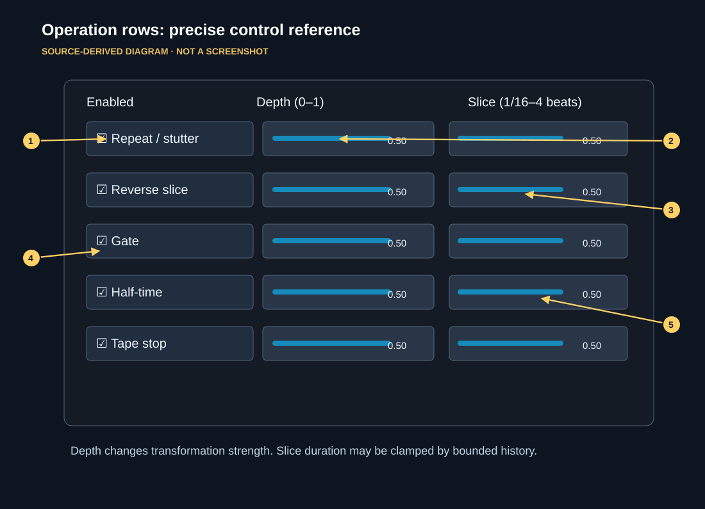

# Interface and control reference

**Image status:** source-derived map matching the default 820 × 720 JUCE editor layout. It is not a captured screenshot. Numbered arrows and highlights link exact regions to the reference below. The window is resizable (minimum 760 × 690; maximum 1400 × 1000); actual positions scale or shift with window width.

| Map | Control | What it does |
| --- | --- | --- |
| 1 | Intensity | Global effect intensity. At 0 the intended result is dry audio. |
| 2 | Dry / wet | Blends processed audio against input. Set above 0 to hear wet output. |
| 3 | Timing method | Automatic, Host PPQ, or Sample Clock. Also affects what happens with missing host fields. |
| 4 | Transition | Immediate, Next Beat, Next Bar, Next Phrase, Manual. Applies to **new** requests. |
| 5 | Manual tempo | Fallback tempo in BPM; source depends on timing mode/host data. |
| 6 | Phrase length | Length in bars for phrase-based quantization/status visualization. |
| 7 | Beats / beat unit | Manual numerator and beat unit (1, 2, 4, 8, 16). |
| 8 | Bypass | Toggles effect bypass; host automation attachment exists. |
| 9 | Timing and status | Read-only transport/timing diagnostics; exposes active or queued state and, when resolvable, samples until switch. |
| 10 | Phrase progress strip | Bar divisions and current position marker when timing is valid. Not an editable step sequencer. |
| 11 | A–D buttons | Request each variation for playback. Labels can show `[active]` or `[queued]`. |
| 12 | Edit A–D selector and name | Choose a variation to **edit**, independently of playback, and rename it. |
| 13 | Trigger queued / Cancel queued | Trigger an armed request now or cancel it. Buttons are disabled when there is no queued request. |
| 14 | Operation rows | Enable and adjust Repeat/stutter, Reverse slice, Gate, Half-time, Tape stop. |
| 15 | Preview/compare/apply/revert | Compare edited versus stored variation without committing until Apply. |
| 16 | Undo / Redo | Undo or redo stored scene edits when history exists; disabled during audition. |
| 17 | MIDI note and note-off policy | Choose a note number for the **edited** variation; optionally return on note-off. |
| 18 | MIDI status | Count of incoming MIDI note events, or “no notes received.” |

## Processing rows

Every row has **Enable** (left), **Depth** (middle, 0–1), and **Slice** (right, 1/16–4 meter beats). A larger slice means a longer rhythmic portion, subject to the internal history limit. Repeat is limited to less than about 1.33 s, Reverse to less than 2 s, and Half-time/Tape stop to less than 4 s. Gate uses its requested interval. These are **effective processing limits**, not promises that all combinations will sound identical across tempos.

- **Repeat / stutter:** repeats a recent audio slice in the active variation.
- **Reverse slice:** plays a prior slice in reverse rather than looking ahead to future samples.
- **Gate:** periodically attenuates or opens the signal.
- **Half-time:** provides a slower, rate-shaped short-window movement; this is not a full offline time-stretcher.
- **Tape stop:** creates a decreasing playback-rate style effect over a slice.

Depth controls how strongly each transformation contributes. The system processes captured short-window history and can fade/mix across operation changes. The precise audible result also depends on the input signal and the active intensity/wet controls.

## Audio, automation, and state notes

The five operation-row settings belong to variations in the internal scene bank; do not assume they appear as host-exposed automation parameters. The top-level controls including Intensity, Dry/Wet, manual timing, timing/transition selection, and Bypass use the processor's parameter state. The plugin is intended to restore stored scenes and parameter state with a saved host project; test the specific DAW before relying on it live.

For modes, fallback, and quantized scheduling, see [Timing](TIMING.md). For interactions, see [Workflows](WORKFLOWS.md).
