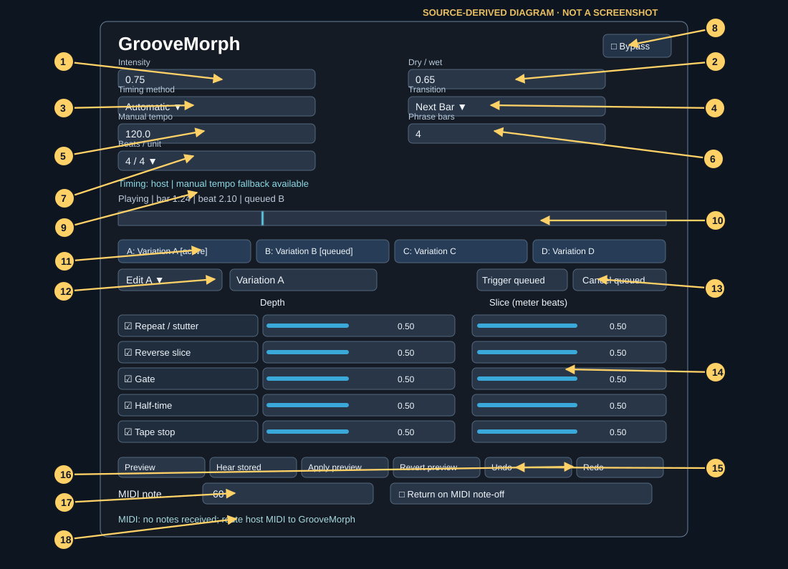

# Quick start

This picture is a source-derived diagram, not a screenshot. Refer to numbers in [Controls](CONTROLS.md).

## 1. Load the effect

Build/install the VST3, or run the JUCE Standalone target; the exact output directory is explained in [Getting Started](../GETTING_STARTED.md). In a DAW, insert **GrooveMorph as an audio effect** on a track or bus that produces sound. Route input audio to it; this plugin does not generate musical notes by itself.

Start with a drum loop or other rhythmic signal. Play the host transport. Keep **Bypass** unchecked and set **Intensity** and **Dry / wet** above zero. If you hear only dry audio, check the selected variation: transformations must be enabled and assigned nonzero depth. The bounded-history algorithms need some incoming audio to establish a valid capture window.

## 2. Choose timing

Choose **Automatic** first. It prefers valid host PPQ musical time and otherwise uses a sample-clock fallback. The line below the timing controls reports host/manual/free-run timing or missing host fields. For a DAW with reliable bar and beat position, try **Host PPQ**. For a preview without a host transport, use **Sample Clock**. See [Timing](TIMING.md) before changing modes during queued transitions.

Enter **Manual tempo (BPM)**, **Manual beats per bar**, **Manual beat unit**, and **Phrase length (bars)** where host information is missing or you need sample-clock fallback. These settings do not override a host's explicit stopped state in Sample Clock mode.

## 3. Select and edit a variation

Click one of the large **A, B, C, D** buttons to request a variation. The button includes `[active]` or `[queued]` in its label. The **Transition** choice determines when the requested variation becomes active: Immediate, Next Beat, Next Bar, Next Phrase or Manual.

**Select the variation to edit separately** using `Edit A` through `Edit D`. Selecting an editor target does not itself queue playback. Optionally rename it in the adjacent name field (commit by Enter or focus change). Each of the five processing rows has an enable checkbox, Depth slider and Slice slider.

## 4. Audition and keep changes

Press **Preview** to enter audition mode for the selected edit target. Tweak the rows; **Hear stored** toggles comparison with the stored version (changes to **Hear edited** while comparing). Use **Apply preview** to keep the auditioned edits or **Revert preview** to abandon them. You cannot change the edit target during an active audition. Closing the editor reverts an unfinished audition.

Outside audition, edits are written to the bank directly and **Undo / Redo** can reverse or reinstate scene edits where history is available. Saving the DAW project stores the plugin state; reopen and verify it in your host.

## 5. Try a quantized scene switch

Set **Transition: Next Bar**, play the track, and click another variation. The status line should show it as queued, with a sample countdown when a boundary can be resolved. **Cancel queued** cancels the request; **Trigger queued** only releases requests made with Transition = Manual. See the scheduler behavior in [Timing](TIMING.md).

## 6. Optional MIDI control

Route MIDI notes from the host to GrooveMorph. In `Edit A/B/C/D`, assign each target variation a **MIDI note** from 0–127; choose **Return on MIDI note-off** if desired. The MIDI status shows the count of received note events. A display of “no notes received” does **not** prove your host cannot route MIDI. See [MIDI workflow](WORKFLOWS.md#control-variation-changes-from-midi).
