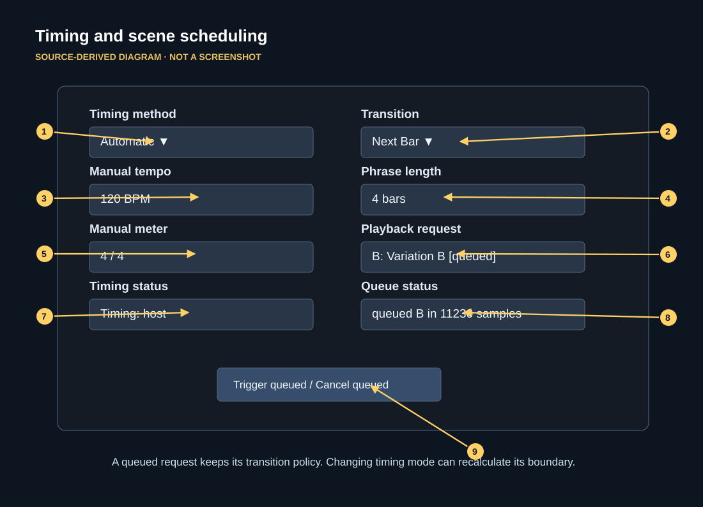

# Timing modes, quantization, and queued transitions

This annotated schematic is derived from the editor source, not a native plugin screenshot.

## Three timing choices

| Mode | Preferred basis | When host information is missing |
| --- | --- | --- |
| **Automatic** | Fresh host PPQ when available, otherwise sample-domain clock | Manual tempo and meter may fill missing valid fields. Missing play state remains stopped; do not interpret this mode as guaranteed free-run. |
| **Host PPQ** | Host musical position (PPQ) | Quantized requests remain armed if PPQ is absent. Beat/bar alignment can also require a credible bar anchor. Rhythmic wet processing can go dry without valid PPQ. Immediate/Manual switching remains possible. |
| **Sample Clock** | Host sample position, or an internal counter with the resolved tempo | Explicitly permits a free-running path without a host playhead; an **explicitly stopped host** remains stopped. It ignores PPQ origins. |

The status line reports host, host + manual, manual, or free-run and warns about missing tempo, meter, play state, position, PPQ or bar anchor where applicable. Prefer working with real transport data in a DAW before attempting musical quantization.

## How the Transition choice works

- **Immediate:** request a variation and switch as soon as the scheduler can apply it.
- **Next Beat:** wait until the next beat-grid boundary.
- **Next Bar:** wait until the next bar boundary.
- **Next Phrase:** wait until the next phrase boundary using Phrase length.
- **Manual:** arm the request until **Trigger queued** is pressed.

A queued request captures its transition policy **when it is requested**. Changing the Transition selector later does not rewrite that policy. Changing **Timing method** can recompute the queued request's boundary against the newly selected clock. A second variation request can replace the earlier pending request; the scheduler retains the latest pending target.

**Trigger queued** can manually activate an existing pending request, regardless of the originally captured transition mode. **Cancel queued** clears it. If the status reports `waiting for trigger/transport`, confirm host transport, timing method and PPQ/bar anchor fields before assuming the switch is broken.

## Phrase strip and positioning

The progress strip shows the phrase subdivisions and a cyan position marker when valid timing exists. Its divisions are based on the current Phrase bars value. The strip is a **status visualization**, not a clickable lane, loop sequencer, or editable phrase-origin control.

## Tempo changes, seeks, loops and host limitations

The processor attempts to detect seeks or loop wraps and discard captured historical audio so that older audio is not replayed after a timeline jump. In PPQ-only hosts, seek detection is limited when a tempo change happens within the same block; host snapshots do not provide continuously interpolated tempo ramps. Changing clock mode or the host playhead can cause a momentary processing change. Perform listening checks in your actual host.

## Diagnosing a held switch

First check `[queued]` on the variation button, then inspect timing diagnostics. If in Host PPQ mode, confirm host PPQ and bar anchors. If the host does not supply those fields, try Automatic or Sample Clock as appropriate, or press Trigger queued. If not playing, start the DAW transport or explicitly use Sample Clock where standalone free-run is intended.
