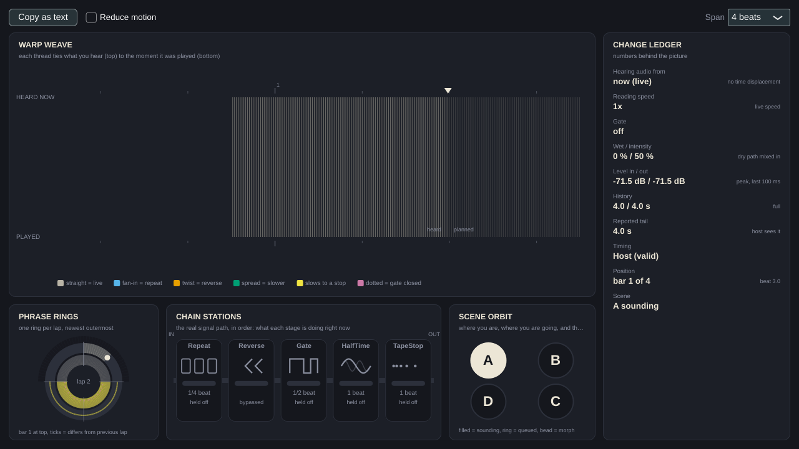

# The Visual window

The **Visual** checkbox in the top row of the main window opens a separate window that shows, live, what GrooveMorph is
doing to your sound. Close it with its close button or **Esc**. While it is closed GrooveMorph records nothing for it.

> Status: alpha. The pictures are drawn from measurements taken inside the effects engine and checked by automated tests
> on Linux and Windows CI. They have **not** been checked in a DAW, with audio hardware, or by listening.
> The screenshots below are software-rendered by the project's snapshot tool, not captured from a Windows desktop.

## Warp Weave (top left)

Every thread ties **a moment of what you are hearing (top row, "HEARD NOW")** to **the moment of input it came from
(bottom row, "PLAYED")**. Both rows use the same beat scale.

| You see | It means |
|---|---|
| Straight vertical threads | You are hearing the input live |
| Threads fanning in to one point (blue) | **Repeat**: the same slice again and again |
| Threads that cross over (orange) | **Reverse**: a slice played backwards |
| Threads that spread apart (green) | **Half-time**: the source moves at half speed |
| Threads that spread and slow to a stop (yellow) | **Tape-stop** |
| Dotted, dimmer threads (pink) | **Gate** closed: that sound is muted |
| Short ticks only | No recorded audio for that moment yet |

The triangle marks "now". Left of it is what you have already heard (solid). Right of it is the **plan** from the active
scene (dimmer): where the sound will come from if nothing changes. Dotted plan threads after a queued scene change are a
guess, because the scene is about to change. The plan does not model audio triggers, phrase evolution or gestures.

The **Span** box chooses 2, 4 or 8 beats across the weave.

## Change Ledger (right)

The numbers behind the picture, for example "Hearing audio from: 1.50 beats ago (750 ms)", reading speed, gate depth,
wet/intensity, input and output peak levels, history fill, reported tail, timing source and validity, position and scene.
**Copy as text** (or press **C**) copies all of it, which is useful for bug reports. A banner at the top says honestly when
effects are bypassed (transport stopped), timing is invalid (and why), a preview is playing, or nothing has been recorded yet.

The in/out levels are shown separately on purpose: effects that play earlier audio can be loud while the current input is quiet.

## Phrase Rings (bottom left)

One ring per **lap of the phrase** (newest outermost, bar 1 at the top). Colours show what was actually happening at each
position. Because every lap uses the same angle, repeated material lines up into radial stripes and a change breaks the
pattern. Small ticks outside the rings mark positions where the newest lap differs from the previous one. A darker wedge
means placement does not let any effect act there. Thin outlines on the newest ring are the plan for the rest of the lap.
Hidden when the window is narrower than about 900 pixels of row width.

## Chain Stations (bottom middle)

The five effects in signal order. Each has its own **shape** (so colour is never the only clue), a bar showing how much of
it is applied, its slice length, and whether it is **active**, **held off** (enabled but gated off right now by a placement
window, event lane or activity limit), **stopped** (transport stopped or timing unavailable) or **bypassed**.

## Scene Orbit (bottom right)

Scenes A to D. Filled = sounding. A ring with a countdown = queued, with the beats left. A bead on the line from the sounding
scene = how far the morph has moved. A dashed line marks the auto-return target.

## Reduce motion, keyboard, accessibility

- **Reduce motion** refreshes the picture 10 times a second instead of 30.
- **C** copies the ledger. **Esc** closes the window. Each view has an accessible name and a text description.
- The colours were checked for contrast and for colour-blind separation by calculation (see
  [PaletteTests](../tests/core/PaletteTests.cpp)). A screen-reader pass and a person-in-the-loop colour-blind review are still to do.

## Limits

Alpha: no DAW, hardware or listening validation. Trace data comes from the audio thread only while the window is open.
If the transport seeks, the picture restarts. Details and the developer specification:
[docs/visual-feedback](../docs/visual-feedback/PLAN.md).
